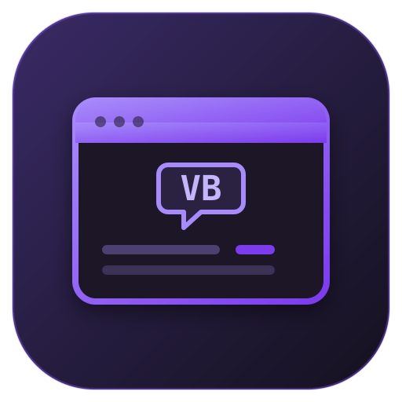

# Rizz Studio

A Visual Studio–style desktop IDE for Linux that builds and runs **VB.NET Windows Forms** applications. It ships a drag-and-drop form designer, a properties/events grid, a Monaco-based VB.NET code editor, and a build/run pipeline that produces real `net472` WinForms executables and runs them with a bundled Mono runtime.

No Windows required. No `sudo` required.



## What it can do

- Create, open, and save VB.NET WinForms projects (`.sln` + `.vbproj`).
- Design forms visually: drop controls from the toolbox, move, resize, align, snap, copy/paste, undo/redo. Select the form to resize it with sizing handles; anchored controls follow, like the VS designer.
- Edit properties in a grouped property grid, including colors, fonts, enums, anchors, padding, and collections.
- Bind and unbind events; Rizz Studio writes the `Handles` clause and a handler stub into the code-behind. The Events grid stays in sync while you edit the handler code.
- Rename or delete forms from the Solution Explorer context menu; rename updates the class, both files, handler names, and `Program.vb`.
- Edit the generated `Form1.Designer.vb` and `Form1.vb` directly in a VB.NET editor.
- Build with the .NET SDK and run the resulting `.exe` with Mono WinForms.
- Preview the form layout in-app without launching Mono.
- Four starter templates: blank form, calculator, menu/toolbar, and dialog.

### Supported controls

Button, Label, LinkLabel, TextBox, RichTextBox, MaskedTextBox, CheckBox, RadioButton, ComboBox, ListBox, CheckedListBox, NumericUpDown, DateTimePicker, PictureBox, ProgressBar, TrackBar, Panel, GroupBox, TabControl, MenuStrip, StatusStrip, ToolStrip, DataGridView, Timer, OpenFileDialog, SaveFileDialog, FolderBrowserDialog, ColorDialog, FontDialog, ErrorProvider, ToolTip.

Containers (Panel, GroupBox, TabControl) accept nested controls. MenuStrip, StatusStrip, ToolStrip, and DataGridView have collection editors for items and columns.

## Requirements

- Linux x86_64 (tested on CachyOS / Wayland with XWayland)
- Node.js 18 or newer (tested with Node 26)
- A working X11 display (`DISPLAY`) — WinForms runs through Mono on X11/XWayland
- Network access on first setup (downloads .NET SDK and Mono)

## Install

```bash
cd bikinstudio
npm install
bash scripts/install-toolchain.sh
npm start
```

`scripts/install-toolchain.sh` installs everything into the user's home directory:

| Component | Location |
| --- | --- |
| .NET SDK 8 | `~/.dotnet` |
| Mono 6.12 + WinForms | `~/.local/share/RizzStudio/mono` |
| libgdiplus / libcairo | `~/.local/share/RizzStudio/mono` |

The script is idempotent — running it again skips components that are already installed. The IDE also has a **Toolchain Manager** panel (left sidebar) that reports what is installed and can re-run the setup.

## Usage

1. **Create a project** — `Ctrl+Shift+N`, choose a template and a folder.
2. **Design the form** — drag controls from the Toolbox onto the form or into a container.
3. **Set properties** — select a control and edit the Properties grid on the right. Use the Events tab to bind an event.
4. **Write code** — `F7` opens the handler for the selected control. The code editor has VB.NET syntax highlighting and completion.
5. **Save** — `Ctrl+S` saves the active form/code file, `Ctrl+Shift+S` saves everything.
6. **Build** — `Ctrl+Shift+B`.
7. **Run** — `F5`. Rizz Studio builds, then starts the app with Mono.

The **Preview** button (designer toolbar) renders a simulated, non-interactive view of the form inside the IDE. Use `F5` for the real application.

### Keyboard shortcuts

| Shortcut | Action |
| --- | --- |
| `Ctrl+Shift+N` | New project |
| `Ctrl+O` | Open project/solution |
| `Ctrl+S` / `Ctrl+Shift+S` | Save / Save all |
| `Ctrl+Shift+B` | Build solution |
| `F5` / `Ctrl+F5` | Start |
| `Ctrl+Q` | Search commands |
| `Ctrl+W` | Close tab |
| `F7` | View code for selection |
| `Shift+F7` | Open designer |
| `F11` | Toggle fullscreen |
| `Ctrl+Z` / `Ctrl+Y` | Undo / redo (designer or editor) |
| `Ctrl+C` / `Ctrl+X` / `Ctrl+V` | Copy / cut / paste |
| `Ctrl+D` | Duplicate selected controls |
| `Ctrl+A` | Select all controls |
| `Delete` | Delete selected controls |
| Arrow keys | Nudge 1 px |
| `Shift`+Arrow | Nudge 10 px |
| `Esc` | Clear selection / close preview |

## Project layout

A generated project looks like this:

```
MyApp/
  MyApp.sln
  MyApp.vbproj
  Program.vb
  Form1.vb
  Form1.Designer.vb
  bin/Debug/net472/MyApp.exe
```

- `Form1.Designer.vb` is the source of truth for the designer model. Rizz Studio serializes the form to real VB.NET designer code and parses it back on load.
- `Form1.vb` is the code-behind. Handlers created through the Events grid are inserted here.
- `Program.vb` calls `Application.Run(New Form1())`.
- The project targets `net472` and references `Microsoft.NETFramework.ReferenceAssemblies` so it can be compiled on Linux.

## How it works

| Layer | Technology |
| --- | --- |
| Desktop shell | Electron |
| Code editor | Monaco |
| Designer | Custom DOM/SVG surface |
| Compiler | .NET SDK 8 (`dotnet build`) targeting `net472` |
| Runtime | Mono 6.12 WinForms (portable extraction) |
| Graphics | libgdiplus 6.1 + libcairo |

Rizz Studio deliberately uses the real `.Designer.vb` file format rather than a proprietary JSON model. That means projects remain readable and editable outside the IDE.

## Limitations

- **Mono, not .NET Framework.** Most WinForms controls work, but Windows-only APIs (registry, WMI, some P/Invoke, native COM controls) will not.
- **No debugger.** `F5` builds and launches the app; it does not attach a step debugger.
- **Preview is a simulation.** It clones the designer surface for layout checking only.
- **Undo after deleting a control** restores the control but not the `Handles` clause that was removed from the code-behind; the handler body itself is never deleted.
- **Resource-backed designer values** (properties serialized with `resources.GetObject`, `CType`, or `DirectCast`, such as images) are not re-emitted by the designer. Edit those in code.
- **No NuGet UI.** You can add `PackageReference` entries to the `.vbproj` manually.
- **Visual styles are approximate.** Mono renders WinForms with its own theme; it will not look identical to Windows 10/11.
- **`Gtk not found ... using built-in colorscheme`** on startup is a harmless Mono warning.
- High-DPI behavior depends on the X11/XWayland scaling setup.
- Only VB.NET is supported. C# projects are not generated.

## Troubleshooting

**Build fails with missing reference assemblies**
Run `bash scripts/install-toolchain.sh` again, or check that `~/.dotnet/dotnet --info` works.

**App does not start / no window appears**
- Check that `DISPLAY` is set and reachable.
- Verify Mono: `~/.local/share/bikinstudio/mono/usr/bin/mono --version`.
- Open the **Output** panel for Mono's stdout/stderr.

**Designer shows a warning about an unsupported control**
The control exists in the `.Designer.vb` but is not in Rizz Studio's catalog. Rizz Studio keeps its declaration, constructor, and property lines verbatim and shows a dashed placeholder on the design surface. You can build and run it normally; edit its properties in code. Saving the form never deletes it.

**Reset window layout**
Use **View → Reset Layout**.

## Development

```bash
npm start              # run the app
npm run dev            # same, with --dev
```

Source files:

```
main.js                  Electron main process, build/run IPC, static server
preload.js               contextBridge API exposed as window.bik
src/index.html           IDE DOM skeleton
src/styles.css           VS-like dark purple theme
src/lib/app.js           application orchestrator, menus, project lifecycle
src/lib/model.js         form model, VB designer serializer/parser
src/lib/designer.js      visual designer
src/lib/props.js         properties and events grid
src/lib/catalog.js       control metadata and property schemas
src/lib/editor.js        Monaco setup and VB language support
scripts/install-toolchain.sh
```

## License

MIT
